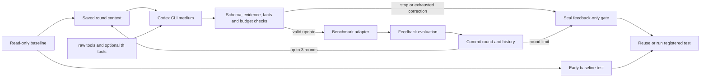

# Backend integration contract

The loop owns diagnosis, verification, budgets, round commits, selection and test registration. A benchmark adapter owns its native formats and runtime. No LIBERO server is contacted by this checkout.

Register a local implementation in `configs/adapters.json`, for example `{"libero": "adapters.libero:LIBERO"}`. `adapters/base.py` is the protocol; `adapters/univtac.py` is the implemented reference. External adapter code must also live inside this loop directory.

A group contains `id`, `benchmark`, `policy`, `task`, `modality`, `target`, `original_steps`, `baseline_train`, `baseline_feedback`, `baseline`, `feedback_seeds`, and `test_seeds`. Additional native fields are allowed in trusted group configuration. The two seed sets must be disjoint and must exclude demonstration seeds.

An artifact contains a stable `id`, `checkpoint`, `stats`, `config`, and `train_dir`. All candidates must be registered artifacts. The model can refer to an artifact ID or its exact registered checkpoint path. Model output cannot register a new path.

| Adapter method | Required behavior |
|---|---|
| `discover` | Return local groups with immutable baseline references. |
| `baseline_summary` | Parse the native summary into `counts.success`; initialization cross-checks it with independently computed episode facts. |
| `raw_files` | Return only current-group source files needed for feedback/history/training evidence. Never expose test results or private runtime state. |
| `episodes` | Normalize native records into seed, outcome, termination, steps, elapsed time, native fields and raw references. |
| `curve`, `facts` | Recompute values from source records. Never trust the model's claims or tool transcript as ground truth. |
| `checkpoints` | Enumerate available registered artifacts. |
| `validate_training_data` | Return errors for invalid IDs, validation overlap or demonstration/evaluation seed overlap. Missing seed metadata is an error. |
| `train` | Strictly load weights, reset optimizer, preserve normalization/validation/architecture, perform exact optimizer updates, return the new artifact. |
| `evaluate` | Preserve native success and stopping rules, use the verified baseline reset retry policy, retain all terminal outcomes, return a complete summary. |

Episode outcomes are `success`, `failure`, `init_error`, `other_error`; terminations are `success`, `max_steps`, `early_stop`, `exception`. `refs` supplies `result`, `native`, `trajectory`, and `videos`. A complete evaluation summary includes `complete`, `artifact_id`, `seeds`, `successes`, and all four outcome counts.

The facts object is defined in `harness/schemas/requirement.schema.json`. It binds claims to the exact artifact, seed list and training run. Stop decisions require the same evidence and facts as update decisions. The primary diagnostic fact metric compares success count, termination distribution, and best validation optimizer step.

The trusted `train(..., save_at_steps=[...])` interface supports controls with multiple checkpoints from one continuous optimization run. This argument is absent from the agent schema. Each save must preserve optimizer continuity; only the initial warm start resets the optimizer.

Recovery relies on explicit artifact identities, request records, round commits and a test registry, without checksums. A completed round can repair its missing history index without executing again. An incomplete training or ambiguous simulator attempt requires reconciliation; it is never silently retried. A protected-directory change records `runs/STOP.json`; do not remove that marker automatically.

Runtime commands use existing Python environments and loop-owned temporary/cache directories. Keep dataset/base-weight access read-only and verify actual module paths against `vendor/` to defeat stale editable installs. All output paths must pass `orchestrator.common.writable`.

## Deployment paths

The local defaults preserve this server's existing environments and read-only directories. On another server, set trusted operator environment variables before initialization:

- `TH_PYTHON`: existing Python interpreter for the orchestrator/MCP server.
- `TH_PI_PYTHON`: existing π0.5 interpreter, when the UniVTAC adapter is used.
- `TH_UNIVTAC_ROOT`: read-only UniVTAC source checkout, when used.
- `TH_PROTECTED_ROOTS`: colon-separated read-only repositories for modification-time auditing.
- `TH_CODEX_BIN`, `TH_CODEX_AUTH`: existing Codex binary and authentication source; runtime copies remain inside the loop.

These are deployment settings, never model action parameters. Output remains confined to the directory containing this implementation. Do not install packages into an existing environment; report missing dependencies instead. LIBERO implementations must use their own native environment and verified baseline retry rule.
